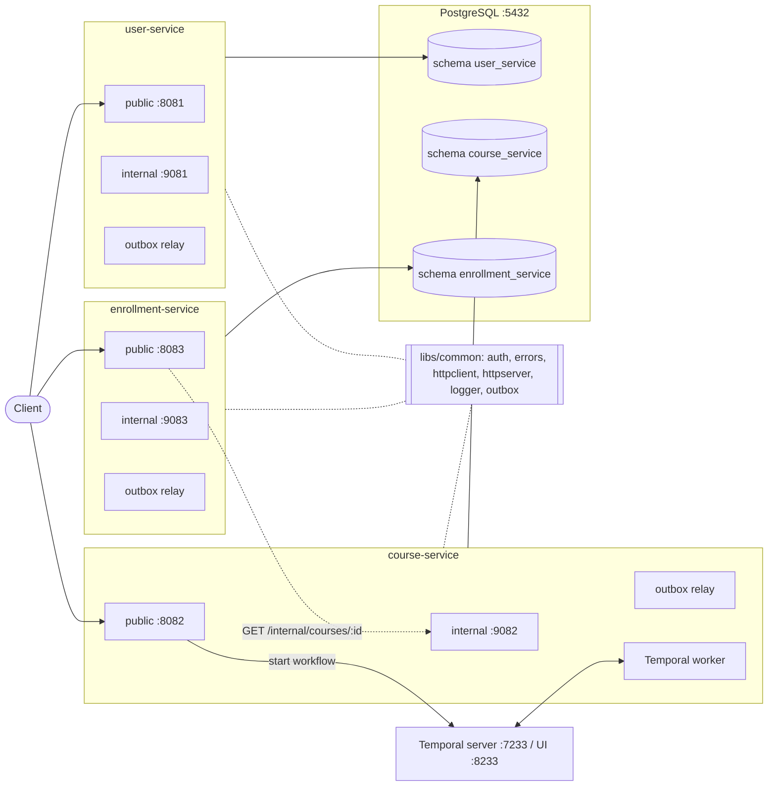

# SmartCourse

SmartCourse is the backend of a course delivery platform. Instructors create courses with modules and lessons and publish them; students enroll in published courses; administrators create user accounts. It is built as three independent Go services (user, course, enrollment) that share one PostgreSQL server but never share tables. Course publishing runs as a Temporal workflow, and every service emits domain events through a transactional outbox.

## Architecture



Only the public ports are published to the host. The internal ports serve `/internal/*` only and are reachable on the Compose network, protected by a shared `X-Internal-Token` key.

## Tech stack

Go 1.26, Gin, GORM, PostgreSQL 15, Liquibase (one changelog set per service), JWT (HS256) with refresh-token rotation, Temporal Go SDK (course-service), Docker Compose.

Planned (Week 3): Kafka event publishing, background workers, analytics, observability (logs, tracing, metrics).

## Setup

Prerequisites: Docker with Compose. Go 1.26 is only needed to run the tests outside Docker.

```
docker compose up --build
```

This starts PostgreSQL, one Liquibase job per service (applies that service's migrations and exits), the three services and a Temporal dev server. The first build downloads the PostgreSQL JDBC driver, so it needs internet access.

| Component | Host port | Notes |
|---|---|---|
| user-service | 8081 | internal listener 9081, Compose network only |
| course-service | 8082 | internal listener 9082, Compose network only |
| enrollment-service | 8083 | internal listener 9083, Compose network only |
| PostgreSQL | 5432 | user `postgres`, password `password`, database `smartcourse_db` |
| Temporal gRPC | 7233 | course-service connects to `temporal:7233` |
| Temporal UI | 8233 | http://localhost:8233 |

Data survives restarts: PostgreSQL uses the `postgres_data` volume and Temporal the `temporal_data` volume. `docker compose down` keeps both; add `-v` to delete them.

### Seeded admin

Only an admin can create users, so user-service creates one admin at startup when both variables are set. Compose sets them with these defaults:

| Variable | Default |
|---|---|
| `ADMIN_EMAIL` | `admin@smartcourse.local` |
| `ADMIN_PASSWORD` | `admin-password-123` |

Log in with `POST /auth/login` on port 8081 and send the returned `access_token` as `Authorization: Bearer <token>`.

### Key environment variables

| Variable | Used by | Default | Purpose |
|---|---|---|---|
| `ENV` | all | `production` (Compose sets `dev`) | Any value other than `dev` requires `JWT_SECRET` and `INTERNAL_API_KEY`, each at least 32 characters |
| `JWT_SECRET` | all | `dev-secret-key` when `ENV=dev` | HS256 signing key; must be identical in every service |
| `INTERNAL_API_KEY` | all | `dev-internal-api-key` when `ENV=dev` | Shared key for `/internal/*`; must be identical in every service |
| `DB_HOST`, `DB_PORT`, `DB_USER`, `DB_PASSWORD`, `DB_NAME` | all | `localhost`, `5432`, `postgres`, `password`, `smartcourse_db` | Database connection |
| `PORT`, `INTERNAL_PORT` | all | 8081/9081, 8082/9082, 8083/9083 | Public and internal listeners |
| `SKIP_LIQUIBASE` | all | unset (Compose sets `true`) | `true` when a separate Liquibase job migrates the database |
| `OUTBOX_POLL_INTERVAL`, `OUTBOX_BATCH_SIZE` | all | `1s`, `100` | Outbox relay tuning |
| `TEMPORAL_HOSTPORT`, `TEMPORAL_NAMESPACE` | course-service | `localhost:7233`, `default` | Temporal connection; the task queue is fixed to `course-service` |
| `COURSE_SERVICE_URL` | enrollment-service | `http://course-service:9082` | course-service internal listener |

Each service has a `.env.example` in its directory.

### Tests

Each Go module is tested on its own (`libs/common` and the three services):

```
cd smartcourse/services/course-service
go test ./...
```

Tests that need a database are skipped unless `SMARTCOURSE_TEST_DSN` is set. Start the stack so the schemas are migrated, then point the variable at it:

```
SMARTCOURSE_TEST_DSN="host=localhost port=5432 user=postgres password=password dbname=smartcourse_db sslmode=disable" go test ./...
```

The repository tests run inside rolled-back transactions, and the outbox tests use throwaway schemas, so they leave no data behind.

## API overview

All public routes except login and refresh require a bearer access token. "Any" means any authenticated role. Routes under `/internal/*` exist on every service for service-to-service calls only, require `X-Internal-Token`, and must not be used by clients or routed by a gateway.

### user-service (:8081)

| Method | Path | Role | Purpose |
|---|---|---|---|
| POST | `/auth/login` | none | Exchange email and password for access and refresh tokens |
| POST | `/auth/refresh` | none (refresh token) | Rotate the refresh token (Bearer header or `refresh_token` cookie) |
| POST | `/api/v1/users` | admin | Create a user with role student, instructor or admin |
| GET | `/api/v1/users/:id` | any | Get a user by id |

### course-service (:8082)

| Method | Path | Role | Purpose |
|---|---|---|---|
| POST | `/api/v1/courses` | instructor | Create a draft course owned by the caller |
| GET | `/api/v1/courses` | any | List courses |
| GET | `/api/v1/courses/:id` | any | Get a course |
| PUT | `/api/v1/courses/:id` | instructor (owner) | Update name, description or enrollment limit of a draft or ready course |
| POST | `/api/v1/courses/:id/publish` | instructor (owner) | Start the publishing workflow; returns 202 |
| POST | `/api/v1/courses/:id/modules` | instructor (owner) | Add a module |
| GET | `/api/v1/courses/:id/modules` | any | List modules (non-owners only once the course is ready) |
| GET | `/api/v1/courses/:id/content` | any | Modules with their lessons (non-owners only once ready) |
| PUT | `/api/v1/modules/:moduleId` | instructor (owner) | Update a module |
| DELETE | `/api/v1/modules/:moduleId` | instructor (owner) | Delete a module |
| POST | `/api/v1/modules/:moduleId/lessons` | instructor (owner) | Add a lesson |
| GET | `/api/v1/modules/:moduleId/lessons` | any | List lessons (non-owners only once ready) |
| PUT | `/api/v1/lessons/:lessonId` | instructor (owner) | Update a lesson |
| DELETE | `/api/v1/lessons/:lessonId` | instructor (owner) | Delete a lesson |

### enrollment-service (:8083)

| Method | Path | Role | Purpose |
|---|---|---|---|
| POST | `/api/v1/enrollments` | student | Enroll the caller in a ready course |
| GET | `/api/v1/enrollments` | any | The caller's own enrollments, newest first |
| GET | `/api/v1/enrollments/:id` | any | One enrollment; only its student or an admin, otherwise 404 |
| POST | `/api/v1/enrollments/:id/cancel` | any (own enrollment) | Cancel the caller's active enrollment and release the seat |

## Weekly tracking

| Week | Focus | Built | Status |
|---|---|---|---|
| 1 | Services, auth and data model | Three Go services in separate modules, schema per service with Liquibase, JWT authentication with refresh rotation and roles, user, course and enrollment APIs, Docker Compose | Done |
| 2 | Reliability and publishing workflow | Transactional outbox and relay, token-based identity, protected internal API, modules and lessons, course status model, enrollment rules (seat limits, cancel, history), Temporal publishing workflow, course update | Done |
| 3 | Events, analytics and observability | Kafka, background workers, analytics, logs, tracing and metrics | Not started |

## Project structure

```
docker-compose.yml
docs/
  PRD.md                  product requirements and traceability
  TECHNICAL.md            architecture, data model, flows, decisions
smartcourse/
  libs/common/            shared module: auth, errors, httpclient, httpserver, logger, outbox
  services/
    user-service/         cmd, config, routes, handlers, services, repositories,
    course-service/       persistence, mappers, domain, migrations, liquibase
    enrollment-service/   (course-service adds workflows/ and worker/)
```

## Documentation

- [docs/TECHNICAL.md](docs/TECHNICAL.md): modules, data model, data and event flows, design decisions
- [docs/PRD.md](docs/PRD.md): requirements, timeline and traceability
