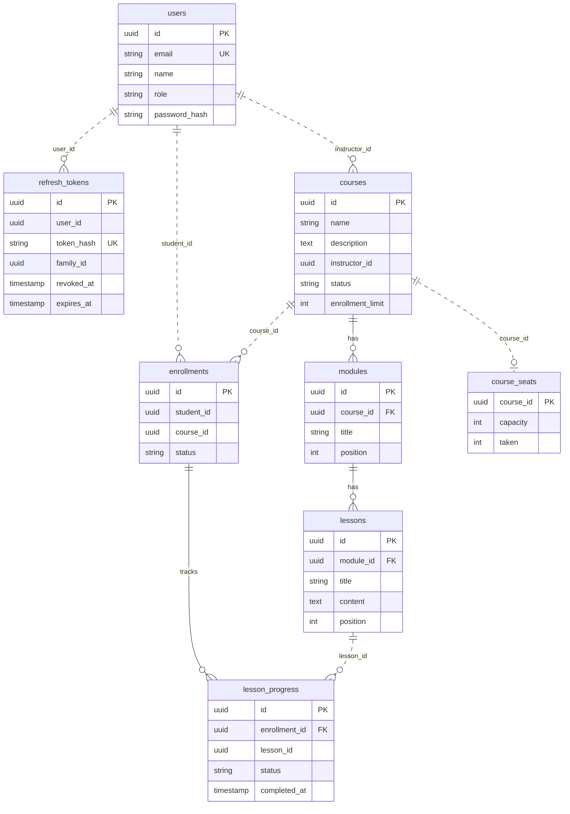
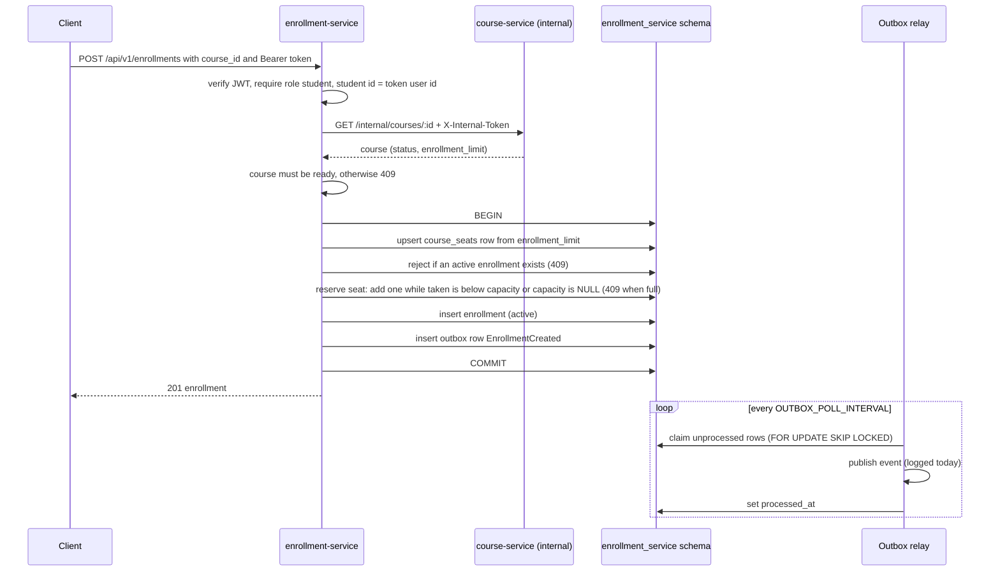
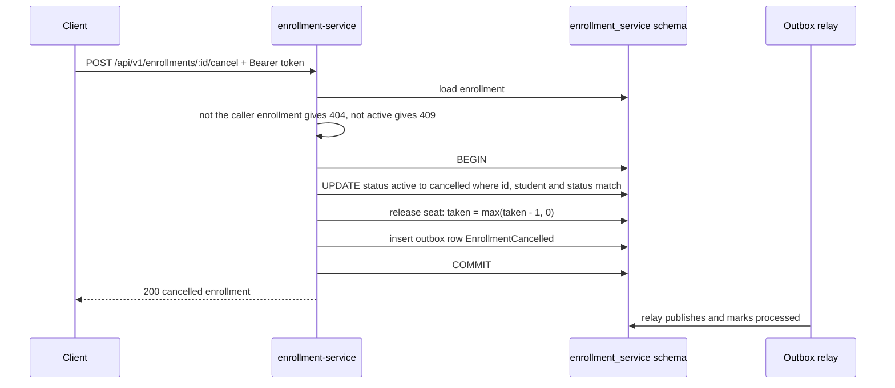
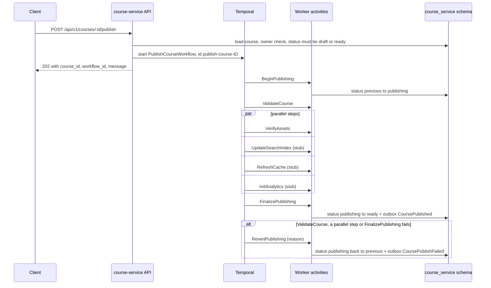
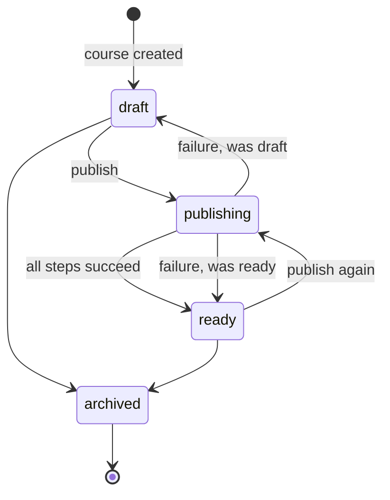

# SmartCourse technical documentation

This document describes what is implemented today. Anything not built is marked "Planned".

## 1. Modules and layering

The repository holds four independent Go modules under `smartcourse/`. Each service's `go.mod` requires `smartcourse/libs/common` and points it at the local directory:

```
replace smartcourse/libs/common => ../../libs/common
```

Docker builds use `smartcourse/` as the build context so the replaced module is available. A service never imports another service.

### libs/common

| Package | Role |
|---|---|
| `auth` | `AuthMiddleware` (verifies the bearer token through a service-supplied function), `RequireRole`, `UserIDFrom` (the only trusted source of caller identity), `InternalAuth` (constant-time `X-Internal-Token` check) |
| `errors` | Typed errors shared by all services (not found, not owned, status conflict, not editable, database, upstream, and so on); handlers map them to HTTP codes with `errors.As` |
| `httpclient` | Client that adds the internal key to every request, and `FetchInternal` for service-to-service GETs (a 404 is a normal "not found" result) |
| `httpserver` | `Run` serves several `http.Server`s (public and internal) and shuts them down together on context cancel |
| `logger` | Structured JSON `slog` logger tagged with the service name |
| `outbox` | `Event`, `NewEvent`, `Insert` (inside the caller's transaction), `Relay` and the `Publisher` interface with `LogPublisher` |

### Service layers

All three services use the same layout; each layer only calls the one below it.

| Package | Role |
|---|---|
| `cmd` | `main`: loads config, migrates (unless `SKIP_LIQUIBASE=true`), opens the database, starts the relay and the HTTP servers, handles shutdown |
| `config` | Reads environment variables; refuses to start outside `ENV=dev` without a real `JWT_SECRET` and `INTERNAL_API_KEY` |
| `routes` | Builds the public and the internal Gin routers and applies auth and role middleware |
| `handlers` | Parse and validate requests, read the caller from the token, map errors to status codes |
| `services` | Business rules; depend on small store interfaces so they are tested without a database |
| `repositories` | GORM access; wrap failures in typed errors; write the outbox row in the same transaction as the business write |
| `persistence` | GORM models; `TableName()` includes the service schema |
| `mappers` | Convert between persistence models and domain entities |
| `domain` | Entities, status constants, event names and payloads |

course-service adds `workflows` (the publish workflow, its activities and the starter) and `worker` (Temporal connection and worker).

## 2. Data model

Each service owns one PostgreSQL schema, created by its own Liquibase changelogs in `services/<service>/migrations`. There are no foreign keys across schemas; dotted lines below are IDs stored as plain UUIDs. Every schema also has an identical `outbox_events` table (`id`, `aggregate_type`, `aggregate_id`, `event_type`, `payload` JSONB, `created_at`, `processed_at`), not drawn.



Constraints that matter:

- `courses.status` is checked against `draft`, `publishing`, `ready`, `archived`; `enrollment_limit` is NULL (unlimited) or greater than 0.
- `modules` is unique on (`course_id`, `position`) and `lessons` on (`module_id`, `position`); both foreign keys cascade on delete.
- `enrollments.status` is `active` or `cancelled`. A partial unique index on (`student_id`, `course_id`) where `status = 'active'` allows one active enrollment per student and course, while a cancelled one can be followed by a new enrollment.
- `course_seats` is checked so that `taken >= 0` and `taken <= capacity`.
- `lesson_progress` (statuses `not_started`, `in_progress`, `completed`) exists in the schema and as a model, but nothing writes to it yet. Planned.
- `refresh_tokens` stores only a SHA-256 hash of the token and a `family_id` used for reuse detection.

## 3. Flows

### 3.1 Enroll



### 3.2 Cancel



The guarded UPDATE is the final authority: if a concurrent cancel won, no row matches and the enrollment is re-read to answer 404 or 409.

### 3.3 Publish



- A second publish while one is running is rejected with 409 (workflow ID conflict policy FAIL); a finished workflow may be run again.
- If `BeginPublishing` itself fails, nothing is reverted because nothing changed.
- All four parallel steps run to completion, and the failure reasons are joined in a fixed order (VerifyAssets, UpdateSearchIndex, RefreshCache, InitAnalytics).
- `ValidateCourse` collects every problem (empty description, module without lessons, lesson with empty title). `VerifyAssets` checks every lesson for non-empty content with a bounded number of goroutines and reports all empty ones in module and lesson order.
- Activities run with a 30 second timeout and up to 3 attempts (5 for the revert); validation and status conflicts are non-retryable. The workflow execution timeout is 10 minutes.
- If Temporal is unreachable at start, the worker is not started and publish answers 503 until the service is restarted.

### 3.4 Outbox events that exist today

Every event is written in the same transaction as the change it describes and delivered at least once by the service's relay, which currently logs it. There are no consumers yet.

| Event | Aggregate | Emitted by | When | Payload |
|---|---|---|---|---|
| `UserRegistered` | `user` | user-service | user created | `user_id`, `email`, `name`, `role` |
| `CourseCreated` | `course` | course-service | course created | `course_id`, `instructor_id`, `name`, `status`, `enrollment_limit` |
| `CoursePublished` | `course` | course-service (`FinalizePublishing`) | course becomes ready | `course_id`, `instructor_id`, `name`, `enrollment_limit` |
| `CoursePublishFailed` | `course` | course-service (`RevertPublishing`) | publishing rolled back | `course_id`, `instructor_id`, `reason` |
| `EnrollmentCreated` | `enrollment` | enrollment-service | enrolled | `enrollment_id`, `student_id`, `course_id`, `status` |
| `EnrollmentCancelled` | `enrollment` | enrollment-service | cancelled | `enrollment_id`, `student_id`, `course_id`, `status` |

## 4. Course status state machine



`domain.CanTransition` defines these moves; same-status moves and any move out of `archived` are not allowed. No endpoint archives a course yet, so `archived` is reachable only in the data model. Content and course fields can be edited only while a course is `draft` or `ready`; non-owners can read content only when it is `ready`; enrollment is open only when it is `ready`.

## 5. Key design decisions

**Independent Go modules per service.** Each service builds, tests and deploys alone and cannot reach into another service's code. Only `libs/common` is shared, and it holds no business logic.

**One schema per service, no cross-schema foreign keys.** A service owns its tables and migrations, so it can move to its own database later. References to other services are plain UUIDs, and the owning service is asked over its internal API when the data is needed.

**Identity always comes from the JWT.** Handlers read the user from the verified access token and ignore `instructor_id` or `student_id` in request bodies. Roles are enforced on the route and ownership in the service. Access tokens last 15 minutes and carry an `access` audience; refresh tokens last 7 days, carry a `refresh` audience, are stored hashed, are rotated on every use, and a reused token revokes its whole family.

**Internal API on a separate, unpublished port plus a shared key.** `/internal/*` is served only on `INTERNAL_PORT`, which Compose does not publish, and every request needs `X-Internal-Token`. Two layers mean a gateway routing mistake does not expose service-to-service routes.

**Transactional outbox.** The event row is inserted in the same transaction as the business change, so an event exists if and only if the change committed. A relay polls unprocessed rows with `FOR UPDATE SKIP LOCKED` (safe with several replicas), publishes in `created_at` order and marks them processed; delivery is at least once. The `Publisher` interface is the seam where a Kafka publisher will replace `LogPublisher` (Planned).

**Temporal for publishing, with idempotent activities.** Publishing has several steps and must be able to roll back cleanly, which Temporal gives through retries, timeouts and durable state. Activities can run more than once, so each is safe to repeat: `BeginPublishing` accepts a course that is already publishing, `FinalizePublishing` accepts one that is already ready, and `RevertPublishing` does nothing when the course is no longer publishing. Status changes are guarded UPDATEs (`WHERE status = ...`), so a lost race is detected rather than overwritten.

**Atomic seat reservation.** Seats live in `course_seats` and are taken with one conditional UPDATE inside the enrollment transaction, so concurrent enrollments cannot exceed the limit, and a failure after the reservation rolls the seat back. A capacity change is picked up on the next enrollment and never drops below the seats already taken.

**Per-service Liquibase jobs.** Each service has its own changelog set and a one-shot Liquibase container that creates the schema and applies only that service's changes, with the tracking tables in the same schema. Services start only after their own job succeeds.

## 6. Assumptions and tradeoffs

- `ready` replaces the earlier `published` status (migration 004 converts existing rows); enrollment checks `ready`.
- The search index, cache refresh and analytics steps of the publishing workflow are stubs that only log.
- Publishing a ready course moves it to `publishing`, so enrollment is closed until the workflow finishes or rolls back; existing enrollments are not affected.
- Ready courses can be edited, including their modules and lessons, without republishing.
- One PostgreSQL instance hosts all schemas for development; separation is logical, not physical.
